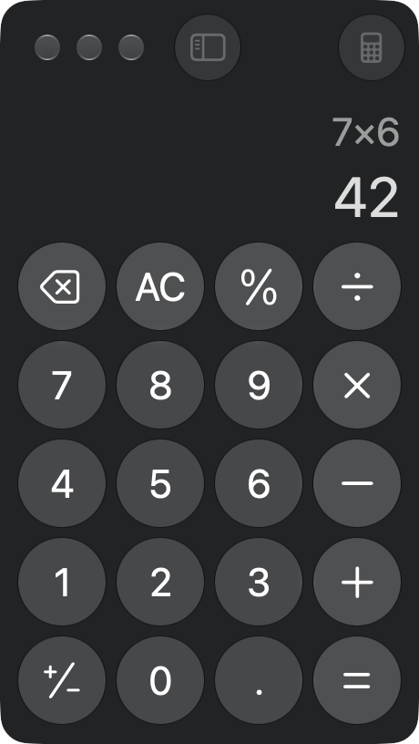
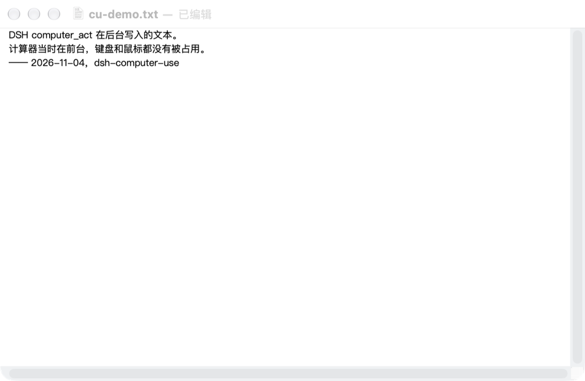
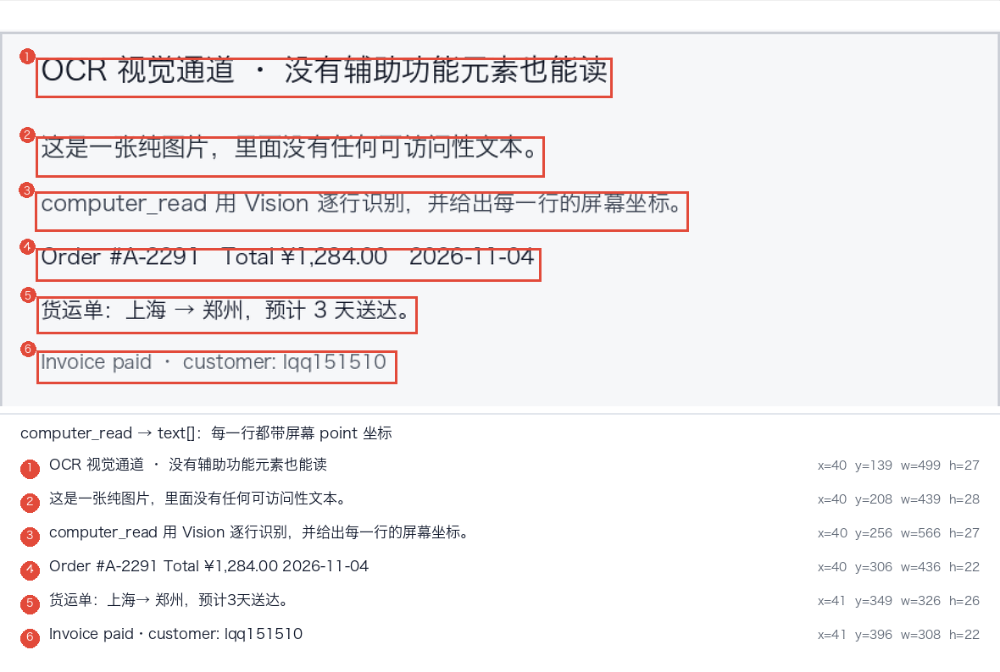

# dsh-computer-use

macOS computer-use plugin for DeepSeek Harness. It registers seven `computer_*` tools: `computer_permissions`, `computer_screenshot`, `computer_windows`, `computer_mouse`, `computer_keyboard`, `computer_read` and `computer_act`.

- **Screen reading** — `computer_read` returns the accessibility tree (role, title, value, actions, screen coordinates, stable `index`) and Vision OCR text with coordinates in one call.
- **Semantic actions** — `computer_act` presses / focuses / sets values / clicks an element by `index` or by visible label through the accessibility API, so it can drive a background window without moving the real pointer. Each action carries a role+title+position fingerprint and re-locates the element when the tree shifts between calls.
- **Pixel path** — `computer_screenshot` captures the display, a window or a region; `computer_mouse` and `computer_keyboard` send real CoreGraphics events for canvases and apps that expose no accessibility elements.

Screenshots use `/usr/sbin/screencapture`; mouse, keyboard and accessibility work is done by a single Swift helper (`native/ComputerUse.swift`) that is compiled with `xcrun swiftc` on first use and cached under `~/.dsh/computer-use/bin/`, so there is no runtime dependency to install. macOS only. Requires the Accessibility and Screen Recording permissions for DeepSeek Harness.

给 DeepSeek Harness 的 macOS「电脑操作」插件：Agent 能截屏看见桌面，并用原生 CoreGraphics 事件移动鼠标、点击、拖拽、滚动、打字和按快捷键。

## 实际跑起来的样子

下面两张是真实运行截图，截取自本机 macOS 27：Agent 先用 `computer_read` 读屏、再用 `computer_act` 操作，然后回读结果。

| 计算器：读屏 → 按标题点击 → 回读 | 后台窗口：不抢焦点直接写 |
| --- | --- |
|  |  |
| 用 `computer_act` 依次 press `7`、`乘`、`6`、`等于`（按可见标题，不按坐标），再用 `computer_read` 读到 `7 × 6` 与 `42`。 | TextEdit 在后台（前台是计算器）时，`computer_act action=set_value` 直接写入文本；之后 `osascript` 回读一致。 |

**第三张：OCR 通道。** 下图里的文字全部来自一张 PNG（用 Preview 打开），辅助功能树里没有任何文本节点。`computer_read` 用 Vision 逐行识别，并把每行的 `x / y / width / height` 一起返回——红框和编号是按真实返回坐标画出来的，不是示意图：



坐标是屏幕 point，可以直接交给 `computer_mouse` 的 `centerX / centerY`，也可以先按文字判断这一行是什么、再决定点不点。

## 它注册了什么

| 工具 | 作用 |
| --- | --- |
| `computer_permissions` | 检查「辅助功能 / 屏幕录制」授权，缺哪个、去哪开 |
| `computer_read` | **读懂屏幕**：辅助功能树（可点元素 role/标题/坐标/index）+ OCR 文字（带坐标），一次拿到 |
| `computer_act` | 按 `computer_read` 的 index 或标题直接 `press` / `focus` / `set_value` / `click`，不靠猜坐标 |
| `computer_screenshot` | 截全屏 / 窗口 / 区域，图片直接进模型上下文（需要看像素时用） |
| `computer_windows` | 列出窗口、查前台 app、把某个 app 切到前台 |
| `computer_mouse` | `move` `click` `double_click` `right_click` `drag` `scroll` `position` |
| `computer_keyboard` | `type`（含中文）`key`（return/tab/esc/方向键/F 键）`hotkey`（cmd+shift+t） |

### 推荐工作流：先读屏，再动手

1. `computer_read`：拿到 `elements`（每个带 `index` 和 `centerX/centerY`）和 `text`（OCR 行 + 坐标）；
2. 能按语义操作就 `computer_act action=press target=<index>`（走 AX，后台窗口也能点，不怕遮挡）；
3. AX 里没有的控件，再用 `computer_mouse` 按坐标点，用 `computer_keyboard` 打字；
4. 改完再 `computer_read` 一次复核结果（比如读输入框 value、读计算器显示）。

`computer_act` 带「元素指纹」（role + 标题 + 坐标）：界面在两次调用之间变了导致 path 漂移时，会重新按指纹在树里找同一个控件，而不是点错按钮。

坐标统一是 **屏幕 point 坐标**，原点在主屏左上角。截图默认降采样到 point 尺寸，所以「图上的像素」就是「点击的 point」；返回值里还带 `origin` 和 `pointsPerPixel` 用于窗口/区域截图换算。

## 与同类插件有什么不同

Dsh 插件列表里已经有好几个 macOS 电脑操作插件（辅助功能优先的、视觉优先的、包一层 Cua Driver 的都有）。下面只列出本插件在实现上做的取舍，方便判断是否合用，不是在比较谁更好：

- **读屏是一个工具，不是一条流水线**：`computer_read` 一次返回「辅助功能树 + OCR 文字」，两条通道共用同一套屏幕 point 坐标，模型不用先选通道，也不用自己做两套换算。
- **按语义操作，不靠坐标碰运气**：`computer_act` 用 `index` 或可见标题在 AX 里定位元素后 `press` / `focus` / `set_value` / `click`，过程中不移动真实指针；每次操作带 role+标题+位置指纹，界面在两次调用之间变化时按指纹重新找同一个控件（上面计算器截图里，清除按钮标题在 `AC` / `C` 之间变化，就是靠这条继续点中的）。
- **可以写后台窗口**：`set_value` 直接作用于目标 app 的 AX 元素，不要求它在前台（第二张截图）。
- **没有外部运行时**：不打包 DMG、不拉 driver 进程、仓库里也没有预编译二进制——Swift 助手在首次调用时由本机 `swiftc` 编译（约 120 KB，源码可审计），之后按源码哈希缓存。
- **失败时说下一步怎么做**：定位不到元素返回 `element-not-found` 并建议重新读屏或改用坐标；权限缺失直接说是哪一项、去哪个系统面板开。

## 授权（一次性）

系统设置 → 隐私与安全性：

1. **辅助功能（Accessibility）** —— 发送鼠标/键盘事件必需；
2. **屏幕录制（Screen Recording）** —— 截图必需。

勾选 `DeepSeek Harness` 后重启 Harness。跑一次 `computer_permissions` 就能看到是否齐全；传 `openSettings: true` 会直接打开对应面板。

当前这台机器两项都已授权，装完即可用。

## 原生助手

`native/ComputerUse.swift` 是唯一的原生部分，首次使用时用 `swiftc` 编译到 `~/.dsh/computer-use/bin/dsh-cu`，按源码哈希缓存，升级插件会自动重编。找不到编译器时工具会返回「先跑 `xcode-select --install`」而不是静默失败。

它刻意不依赖 pyautogui / cliclick / robotjs：一个 ~120 KB 的静态 Swift 可执行文件，只链 AppKit/CoreGraphics，命令通过 argv 传 JSON、stdout 回 JSON。

## 配置

`cordis.patch.yml` 里可调：

```yaml
- id: computer-use
  name: dsh-computer-use
  config:
    allowInput: true       # false = 只截图，禁用鼠标键盘
    resolution: points     # points（推荐）| pixels
    defaultDisplay: 1
    blockedApps:           # 这些 app 在前台时拒绝发送输入
      - 1Password
      - Keychain Access
    typeMaxChars: 8000
    warmup: true           # 启动时后台预编译助手
```

## 边界与已知限制

- 只实现 macOS；其他平台工具会直接说明不支持。
- 输入是「全局合成事件」，发给**当前前台窗口**，插件不会切窗口——先用 `computer_windows` 确认、必要时 `activate`。
- `type` 走 Unicode 事件直接插入文本，不经过输入法候选；对个别只认物理键位的游戏/远程桌面可能无效。
- AX 不是万能的：自绘界面（部分 Electron / 游戏 / 画布）可交互元素很少，这时退回 OCR + 坐标点击。
- `computer_read` 的 OCR 默认 `zh-Hans + en-US`、精确模式、原分辨率；窗口级约 0.3–1 秒，整屏可能要十几秒。只要文字不问像素时用它，别用截图硬猜。
- OCR 语言顺序有讲究：`zh-Hans` 必须在最前，`en-US` 在前会让中文识别质量暴降。
- 截图默认落在 `$TMPDIR/dsh-computer-use/`，20 分钟后自动清理。

## 改完代码怎么生效

插件是 `link:` 进 profile 的，改 `lib/*.js` 后需要重新加载一次：

```bash
# 在 DSH 里调 plugin_manager：
#   action=set_plugin target=include:computer-use enabled=false
#   action=set_plugin target=include:computer-use enabled=true
```

（原生 Swift 改动不用重载插件：`lib/helper.js` 按源码哈希自动重编译。）

## 卸载

```bash
dsh plugin --profile desktop remove dsh-computer-use
rm -rf ~/.dsh/computer-use
```
